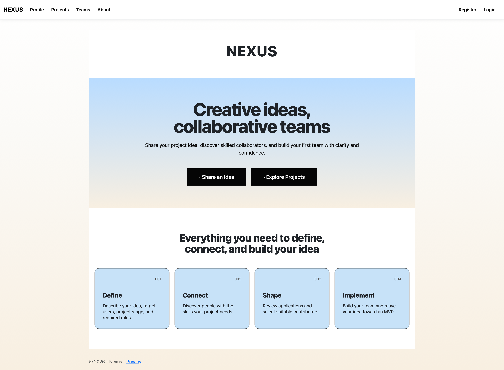
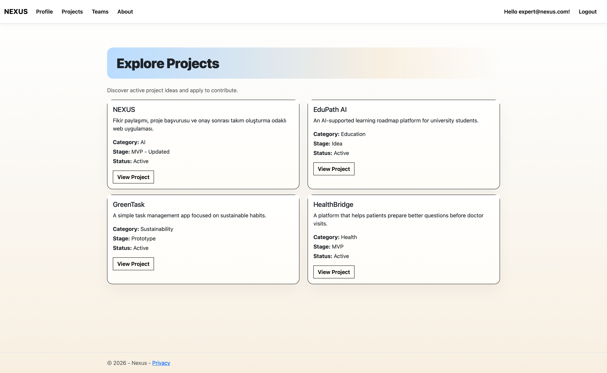
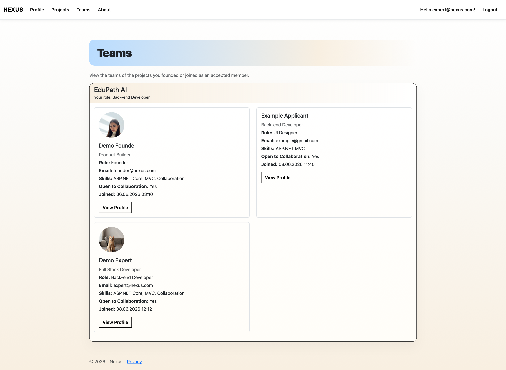

# Nexus

### A collaborative project platform built with ASP.NET Core MVC.

Nexus connects people who have project ideas with developers, designers and other collaborators who want to join them.

---

## About

Nexus is an ASP.NET Core MVC web application designed around project collaboration.

Users can create project ideas, discover active projects, apply for specific roles and build teams through a founder approval workflow.

The project was developed as part of the **Programming for the Internet** course and later refined as a portfolio project with a focus on authentication, relational data modelling, authorization and complete user workflows.

---

## Preview

### Home

### Explore Projects

### Teams

## Main Features

- User registration and authentication with ASP.NET Core Identity
- Editable user profiles
- Profile photo upload
- Skills, experience level and professional information
- Project creation, editing and deletion
- Public project discovery through the Explore page
- Role-based project applications
- Profile completion requirement before applying
- Duplicate application prevention
- Founder approval and rejection workflow
- Automatic team membership after approval
- Created and joined project tracking
- Team member profiles
- Authorization rules for protected project and profile data
- Seeded demo users and projects

---

## Core User Flow

### Founder

1. Register or log in
2. Complete a profile
3. Create a project
4. Publish the project to Explore
5. Review incoming applications
6. Accept or reject applicants
7. Manage the resulting project team

### Collaborator

1. Register or log in
2. Complete a profile
3. Explore available projects
4. Open a project
5. Apply for a specific role
6. Wait for founder review
7. Join the team after approval

---

## Tech Stack

| Area | Technology |
| --- | --- |
| Backend | ASP.NET Core MVC |
| Language | C# |
| UI | Razor Views, HTML, CSS, Bootstrap |
| Authentication | ASP.NET Core Identity |
| ORM | Entity Framework Core |
| Database | SQLite |
| Querying | LINQ |
| Version Control | Git & GitHub |

---

## Data Model

The main domain relationships are built around four core entities:

- `ApplicationUser`
- `Project`
- `ProjectApplication`
- `ProjectMember`

A project has one founder, can receive multiple applications and can contain multiple accepted members.

Unique database constraints prevent the same user from:

- applying to the same project more than once
- becoming a duplicate member of the same project

---

## Authorization

Nexus includes authorization rules beyond basic authentication.

Examples include:

- only project founders can edit or delete their projects
- only founders can review applications
- users cannot apply to their own projects
- existing team members cannot apply again
- project details are protected based on the user's relationship with the project
- detailed user profiles are visible only when users share a project

---

## Profile Image Upload

Profile images are stored under:

    wwwroot/uploads/profiles

Only the stored path is persisted in the database.

Uploaded profile images are limited to:

- JPG
- JPEG
- PNG
- WEBP
- Maximum file size: 5 MB

User-uploaded files are excluded from Git version control.

---

## Demo Accounts

The application automatically creates demo users for testing.

### Founder

    Email: founder@nexus.com
    Password: Founder123!

### Collaborator

    Email: expert@nexus.com
    Password: Expert123!

The database is also seeded with example projects so the Explore workflow can be tested immediately.

---

## Getting Started

### 1. Clone the repository

    git clone https://github.com/mervka/Nexus.git
    cd Nexus

### 2. Restore dependencies

    dotnet restore

### 3. Apply database migrations

    dotnet ef database update

### 4. Run the application

    dotnet run

Open the localhost address displayed in the terminal.

---

## Project Structure

    Nexus/
    ├── Areas/
    │   └── Identity/
    ├── Controllers/
    ├── Data/
    │   ├── Migrations/
    │   └── Seed/
    ├── Models/
    ├── ViewModels/
    ├── Views/
    ├── wwwroot/
    ├── Program.cs
    └── Nexus.csproj

---

## What I Practiced

This project gave me hands-on experience with:

- ASP.NET Core MVC architecture
- authentication and authorization
- Entity Framework Core relationships
- database migrations
- relational data modelling
- server-side validation
- Razor Views
- file uploads
- user-specific workflows
- CRUD operations
- LINQ queries
- application state and permission handling

---

## Project Status

Nexus is currently an **MVP**.

Potential future improvements include:

- notification system
- real-time messaging
- project search and filtering
- richer skill matching
- project milestones and task management
- production deployment

---

Built as a project collaboration platform with ASP.NET Core MVC.

